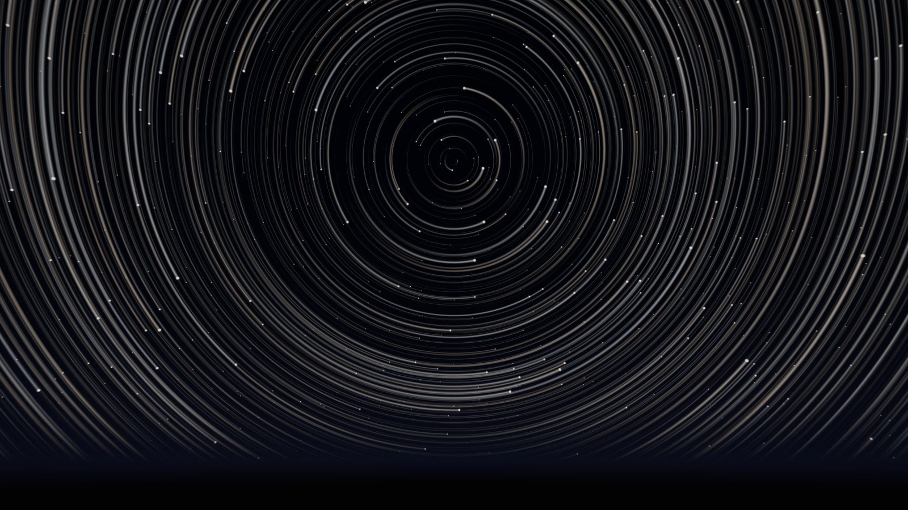
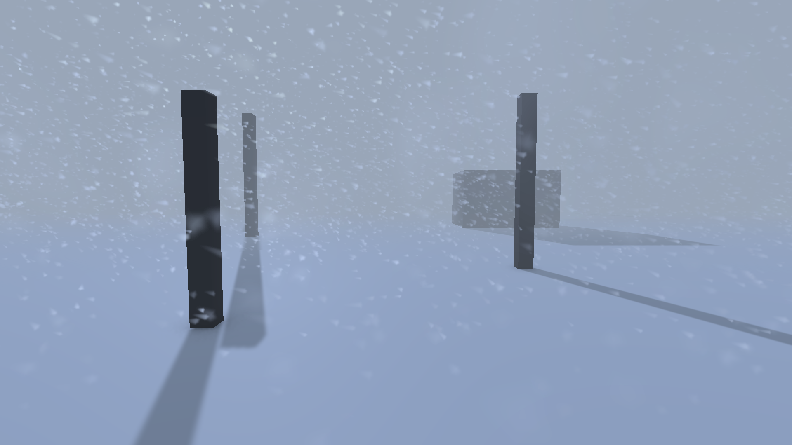

# 나만의 셰이더 제작 — 제출 문서

| # | 셰이더 | 분야 | 방식 | 데모 씬 |
| --- | --- | --- | --- | --- |
| 01 | StarTrailSky | 스카이박스 | HLSL | `Assets/00. Scenes/MyShader_StarTrailSky.unity` |
| 02 | Blizzard | 파티클 이펙트 | HLSL (정점 셰이더 + Custom Vertex Streams) | `Assets/00. Scenes/MyShader_Blizzard.unity` |

---

## 01. StarTrailSky — 별의 일주 운동과 잔상

- 경로: `Assets/02. MyShaders/01_StarTrailSky/StarTrailSky.shader` (`MyShaders/StarTrailSky`)
- 확인 방법: 데모 씬을 열거나, `Lighting > Environment > Skybox Material`에 `StarTrailSky.mat`을 넣는다.

### 동작 원리
1. **천구 좌표계**: 픽셀이 바라보는 방향을 천구 북극 기준 극좌표(θ = 북극에서 떨어진 각, φ = 방위각)로 바꾼다. 별의 일주 운동은 북극 축 회전이므로 φ에 시간을 더하기만 하면 하늘 전체가 돈다.
2. **절차적 별 배치**: θ를 고리로, 각 고리를 φ 방향 칸으로 나누고 칸마다 해시 난수로 별의 유무·위치·밝기·색을 정한다. 칸 수를 고리 둘레(sin θ)에 비례시켜 하늘 전체 밀도를 고르게 한다.
3. **잔상**: 별은 같은 고리 위로만 움직이므로, 픽셀의 진행 방향 앞쪽 칸들을 확인해 "별이 이 픽셀을 지나간 뒤 이동한 각도(age)"에 따라 밝기를 줄여 궤적을 그린다.
4. **깜빡임 방지**: `fwidth`로 픽셀 크기를 구해 별 폭을 최소 1픽셀로 넓히고, 넓힌 만큼 밝기를 낮춘다.

### 주요 프로퍼티
북극 고도/방위, 회전 속도(부호 = 방향), 고리 수, 별 확률/크기/밝기/반짝임/색 다양성, 잔상 길이/밝기/감쇠.

---

## 02. Blizzard — 자연스러운 눈보라 파티클

- 경로: `Assets/02. MyShaders/02_Blizzard/Blizzard.shader` (`MyShaders/Blizzard`)
- 머티리얼: `Blizzard.mat` (눈송이), `Blizzard_Gust.mat` (바람에 휩쓸리는 눈가루 덩어리, 같은 셰이더)
- 텍스처를 쓰지 않는다. 눈송이 모양은 전부 셰이더에서 계산한다.

### 목표
눈송이가 모두 같은 크기·선명도의 동그란 스티커처럼 보이지 않게 하는 것. 실제 눈보라 사진처럼 가까운 눈은 크게 번지고, 먼 눈은 안개 속으로 사라지고, 빠른 눈은 길게 끌리게 했다.

### 동작 원리
Particle System은 눈송이의 위치·속도·크기만 정하고, 모양과 표현은 셰이더가 정한다.
파티클 정보는 **Custom Vertex Streams**로 받는다 (순서: Position, Color, UV, StableRandom.xy, Center, Size.x, Velocity).

1. **속도 방향으로 늘이기 (정점 셰이더)**
   파티클 속도에서 시선 방향 성분을 빼서 "화면에 보이는 이동 방향"을 구하고, 그 방향으로 사각형을 직접 다시 만든다. 머리는 파티클 위치에 두고 지나온 쪽으로 꼬리를 늘인다. 꼬리 길이 = 화면상 속도 × 노출 시간(`_StretchAmount`).
2. **거리에 따른 흐림 (카메라 초점 흉내)**
   초점 범위(`_FocusDistance ± _FocusRange`)에서 벗어날수록 눈송이를 키우고(`_BokehGrow`) 가장자리를 부드럽게 한다. 넓어진 면적(크기²)만큼 불투명도를 낮춰 전체 밝기는 유지한다. 카메라 바로 앞 눈은 큰 흐린 빛망울이 된다.
3. **캡슐 모양 + 불규칙한 가장자리 (프래그먼트 셰이더)**
   머리에서 꼬리 끝까지의 선분까지 거리로 캡슐을 그리고, 꼬리 쪽일수록 옅게 한다. 가장자리는 파티클마다 다른 난수로 위상이 다른 사인파 두 개를 더해 일그러뜨린다.
4. **빛나지 않는 눈**
   가산 혼합 대신 알파 블렌딩을 쓰고, 색은 환경광(`SampleSH`)과 주광으로 정한다. 해를 마주 볼 때만 밝아지는 전방 산란과, 납작한 눈송이가 구르며 빛을 받는 반짝임을 더했다.
5. **자연스럽게 사라지기**
   URP 안개(`MixFog`)로 먼 눈을 공기 속에 녹이고, Soft Particle(깊이 텍스처와 비교)로 바닥·물체와 닿는 곳을, Near Fade로 카메라 바로 앞을 부드럽게 지운다.
6. **눈가루 덩어리 (`_Wispiness`)**
   같은 셰이더에서 값 노이즈 3옥타브(fBm)로 구멍을 뚫으면, 크고 흐린 파티클이 바람에 날리는 눈가루처럼 보인다.

### 데모 씬 구성
| 오브젝트 | 역할 |
| --- | --- |
| `Snow_Far` | 멀리 촘촘하게 날리는 작은 눈 (대부분 안개 속) |
| `Snow_Mid` | 초점이 맞는 거리의 주된 눈 |
| `Snow_Near` | 가끔 카메라를 스치는 큰 흐린 눈 |
| `Snow_Gusts` | 바람에 휩쓸리는 눈가루 덩어리 (`Blizzard_Gust.mat`) |
| `Environment` | 바닥과 거리별 기둥/오두막 (안개·Soft Particle 확인용) |

바람은 각 파티클 시스템의 Velocity over Lifetime(파티클마다 다른 속도)과 Noise 모듈(소용돌이)로 만든다.
씬과 머티리얼은 `Editor/BlizzardDemoBuilder.cs`(메뉴 `MyShaders > Build Blizzard Demo`)로 다시 만들 수 있다.

### 주요 프로퍼티
| 그룹 | 프로퍼티 |
| --- | --- |
| Lighting | 환경광 세기, 주광 세기, 전방 산란 |
| Shape | 가장자리 부드러움, 불규칙함, 반짝임, 눈가루(노이즈) 정도/크기/흐름 속도 |
| Motion Stretch | 노출 시간(꼬리 길이), 최대 늘어남 |
| Depth Of Field | 초점 거리, 초점 범위, 먼 쪽 흐림 거리, 흐림에 따른 크기 증가 |
| Fading | Soft Particle 사용/거리, Near Fade 시작/범위 |

### 참고
- Soft Particle은 URP 에셋의 **Depth Texture**가 켜져 있어야 한다 (`PC_RPAsset`은 켜져 있음). 꺼진 환경에서는 머티리얼의 Soft Particles 토글을 끈다.
- 정점 셰이더가 Custom Vertex Streams 순서에 의존하므로, 다른 파티클 시스템에 쓸 때는 Renderer의 Custom Vertex Streams를 위 순서대로 맞춰야 한다.
