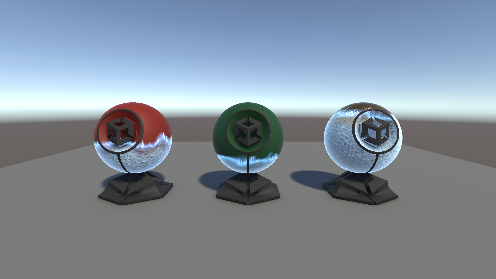
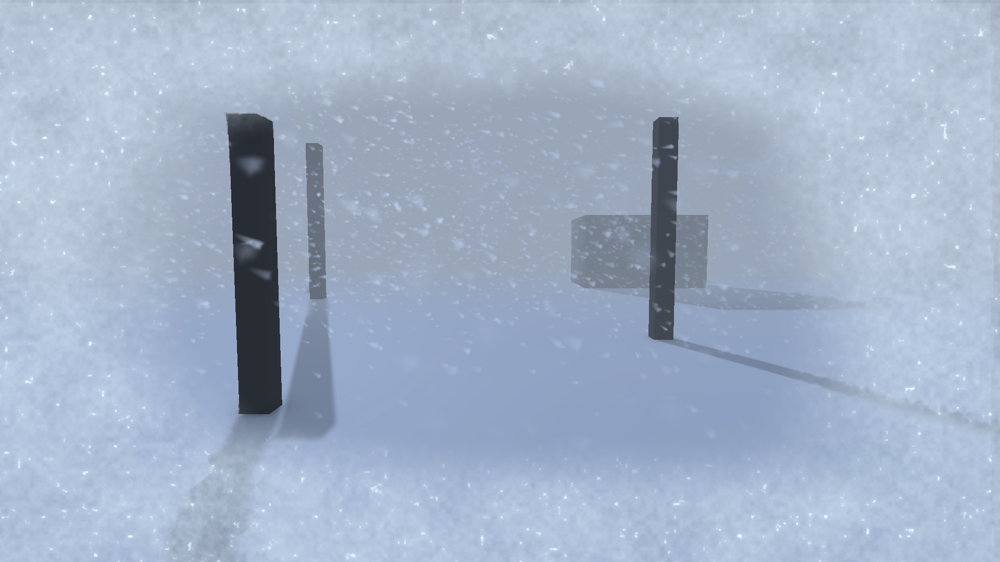

# 나만의 셰이더 제작 — 제출 문서

| # | 셰이더 | 분야 | 방식 | 데모 씬 |
| --- | --- | --- | --- | --- |
| 01 | StarTrailSky | 스카이박스 | HLSL | `Assets/00. Scenes/MyShader_StarTrailSky.unity` |
| 02 | Blizzard | 파티클 이펙트 | HLSL (정점 셰이더 + Custom Vertex Streams) | `Assets/00. Scenes/MyShader_Blizzard.unity` |
| 03 | FrozenSurface | 3D 오브젝트 표면 | Shader Graph (URP Lit) | `Assets/00. Scenes/MyShader_FrozenSurface.unity` |
| 04 | LensFrost | 화면 효과 (후처리) | Shader Graph (URP Fullscreen) + Full Screen Pass | `Assets/00. Scenes/MyShader_LensFrost.unity` |

네 셰이더는 "겨울밤"이라는 하나의 테마로 묶여 있지만, 분야(하늘 / 파티클 / 물체 표면 / 화면)와 방식(HLSL 2개, Shader Graph 2개)이 모두 다릅니다.

---

## 01. StarTrailSky — 별의 일주 운동과 잔상

- 경로: `Assets/02. MyShaders/01_StarTrailSky/StarTrailSky.shader` (`MyShaders/StarTrailSky`)
- 확인 방법: 데모 씬을 열거나, `Lighting > Environment > Skybox Material`에 `StarTrailSky.mat`을 넣는다.

### 동작 원리
1. **천구 좌표계**: 픽셀이 바라보는 방향을 천구 북극 기준 극좌표(θ = 북극에서 떨어진 각, φ = 방위각)로 바꾼다. 별의 일주 운동은 북극 축 회전이므로 φ에 시간을 더하기만 하면 하늘 전체가 돈다.
2. **절차적 별 배치**: θ를 고리로, 각 고리를 φ 방향 칸으로 나누고 칸마다 해시 난수로 별의 유무·위치·밝기·색을 정한다. 칸 수를 고리 둘레(sin θ)에 비례시켜 하늘 전체 밀도를 고르게 한다.
3. **잔상**: 별은 같은 고리 위로만 움직이므로, 픽셀의 진행 방향 앞쪽 칸들을 확인해 "별이 이 픽셀을 지나간 뒤 이동한 각도(age)"에 따라 밝기를 줄여 궤적을 그린다.
4. **깜빡임 방지**: `fwidth`로 픽셀 크기를 구해 별 폭을 최소 1픽셀로 넓히고, 넓힌 만큼 밝기를 낮춘다.

### 주요 프로퍼티
북극 고도/방위, 회전 속도(부호 = 방향), 고리 수, 별 확률/크기/밝기/반짝임/색 다양성, 잔상 길이/밝기/감쇠.

---

## 02. Blizzard — 자연스러운 눈보라 파티클

- 경로: `Assets/02. MyShaders/02_Blizzard/Blizzard.shader` (`MyShaders/Blizzard`)
- 머티리얼: `Blizzard.mat` (눈송이), `Blizzard_Gust.mat` (바람에 휩쓸리는 눈가루 덩어리, 같은 셰이더)
- 텍스처를 쓰지 않는다. 눈송이 모양은 전부 셰이더에서 계산한다.

### 목표
눈송이가 모두 같은 크기·선명도의 동그란 스티커처럼 보이지 않게 하는 것. 실제 눈보라 사진처럼 가까운 눈은 크게 번지고, 먼 눈은 안개 속으로 사라지고, 빠른 눈은 길게 끌리게 했다.

### 동작 원리
Particle System은 눈송이의 위치·속도·크기만 정하고, 모양과 표현은 셰이더가 정한다.
파티클 정보는 **Custom Vertex Streams**로 받는다 (순서: Position, Color, UV, StableRandom.xy, Center, Size.x, Velocity).

1. **속도 방향으로 늘이기 (정점 셰이더)**
   파티클 속도에서 시선 방향 성분을 빼서 "화면에 보이는 이동 방향"을 구하고, 그 방향으로 사각형을 직접 다시 만든다. 머리는 파티클 위치에 두고 지나온 쪽으로 꼬리를 늘인다. 꼬리 길이 = 화면상 속도 × 노출 시간(`_StretchAmount`).
2. **거리에 따른 흐림 (카메라 초점 흉내)**
   초점 범위(`_FocusDistance ± _FocusRange`)에서 벗어날수록 눈송이를 키우고(`_BokehGrow`) 가장자리를 부드럽게 한다. 넓어진 면적(크기²)만큼 불투명도를 낮춰 전체 밝기는 유지한다. 카메라 바로 앞 눈은 큰 흐린 빛망울이 된다.
3. **캡슐 모양 + 불규칙한 가장자리 (프래그먼트 셰이더)**
   머리에서 꼬리 끝까지의 선분까지 거리로 캡슐을 그리고, 꼬리 쪽일수록 옅게 한다. 가장자리는 파티클마다 다른 난수로 위상이 다른 사인파 두 개를 더해 일그러뜨린다.
4. **빛나지 않는 눈**
   가산 혼합 대신 알파 블렌딩을 쓰고, 색은 환경광(`SampleSH`)과 주광으로 정한다. 해를 마주 볼 때만 밝아지는 전방 산란과, 납작한 눈송이가 구르며 빛을 받는 반짝임을 더했다.
5. **자연스럽게 사라지기**
   URP 안개(`MixFog`)로 먼 눈을 공기 속에 녹이고, Soft Particle(깊이 텍스처와 비교)로 바닥·물체와 닿는 곳을, Near Fade로 카메라 바로 앞을 부드럽게 지운다.
6. **눈가루 덩어리 (`_Wispiness`)**
   같은 셰이더에서 값 노이즈 3옥타브(fBm)로 구멍을 뚫으면, 크고 흐린 파티클이 바람에 날리는 눈가루처럼 보인다.

### 데모 씬 구성
| 오브젝트 | 역할 |
| --- | --- |
| `Snow_Far` | 멀리 촘촘하게 날리는 작은 눈 (대부분 안개 속) |
| `Snow_Mid` | 초점이 맞는 거리의 주된 눈 |
| `Snow_Near` | 가끔 카메라를 스치는 큰 흐린 눈 |
| `Snow_Gusts` | 바람에 휩쓸리는 눈가루 덩어리 (`Blizzard_Gust.mat`) |
| `Environment` | 바닥과 거리별 기둥/오두막 (안개·Soft Particle 확인용) |

바람은 각 파티클 시스템의 Velocity over Lifetime(파티클마다 다른 속도)과 Noise 모듈(소용돌이)로 만든다.
씬과 머티리얼은 `Editor/BlizzardDemoBuilder.cs`(메뉴 `MyShaders > Build Blizzard Demo`)로 다시 만들 수 있다.

### 주요 프로퍼티
| 그룹 | 프로퍼티 |
| --- | --- |
| Lighting | 환경광 세기, 주광 세기, 전방 산란 |
| Shape | 가장자리 부드러움, 불규칙함, 반짝임, 눈가루(노이즈) 정도/크기/흐름 속도 |
| Motion Stretch | 노출 시간(꼬리 길이), 최대 늘어남 |
| Depth Of Field | 초점 거리, 초점 범위, 먼 쪽 흐림 거리, 흐림에 따른 크기 증가 |
| Fading | Soft Particle 사용/거리, Near Fade 시작/범위 |

### 참고
- Soft Particle은 URP 에셋의 **Depth Texture**가 켜져 있어야 한다 (`PC_RPAsset`은 켜져 있음). 꺼진 환경에서는 머티리얼의 Soft Particles 토글을 끈다.
- 정점 셰이더가 Custom Vertex Streams 순서에 의존하므로, 다른 파티클 시스템에 쓸 때는 Renderer의 Custom Vertex Streams를 위 순서대로 맞춰야 한다.

---

## 03. FrozenSurface — 아래에서부터 얼어붙는 표면

- 경로: `Assets/02. MyShaders/03_FrozenSurface/FrozenSurface.shadergraph` (`MyShaders/FrozenSurface`, URP Lit 타깃)
- 머티리얼 3종: `FrozenSurface_Half.mat`(반쯤 언 붉은 표면), `FrozenSurface.mat`(얼었다 녹았다 반복), `FrozenSurface_Metal.mat`(거의 다 언 금속)
- 셰이더볼 3개에 적용한 데모 씬. 텍스처 없이 노드만으로 만들었다.

### 동작 원리 (그래프 순서대로)
1. **얼음 높이(Freeze Front)**: `Freeze Amount`(0~1)로 `Freeze Bottom`~`Freeze Top` 사이의 높이를 `Lerp`해서 얼음이 차오른 월드 Y 높이를 정한다. `Animate Freeze`를 켜면 `Time → Sine`으로 만든 0~1 값을 대신 써서 얼었다 녹았다 반복한다.
2. **일렁이는 경계**: 월드 위치 `(x+z, y)`를 UV로 쓴 `Simple Noise`를 경계 높이에 더한다. `경계 높이 − 픽셀 높이 > 0`이면 얼음이고, `Smoothstep`으로 원래 표면과 얼음을 부드럽게 섞을 마스크(iceMask)를 만든다.
3. **빛나는 얼음선**: 같은 거리 값의 절댓값으로 경계에서만 1이 되는 띠(`Abs → Divide → One Minus → Saturate → Power`)를 만들어 HDR 색을 곱해 Emission에 더한다.
4. **결정 (바이플래너 Voronoi)**: `Voronoi`를 XY 평면과 ZY 평면에 각각 투영하고, 표면 법선의 X/Z 성분 비율로 섞는다. 한 방향 투영만 쓰면 옆면에서 무늬가 길게 늘어나기 때문이다. 결정의 색은 주로 셀마다 하나인 값(Cells)으로 정해서, 결정 하나하나가 고르게 한 가지 색을 갖게 한다.
5. **결정 면(facet)**: Cells 값과 그것을 `Fraction(Cells × 37.71)`로 섞은 두 번째 난수로 결정마다 다른 기울기의 노멀 `(x, y, 1)`을 만든다. 결정 안에서는 노멀이 일정하므로 평평한 면이 되고, 결정마다 빛을 다르게 반사해 깎은 보석처럼 보인다. 여기에 `Normal From Height`의 약한 요철을 더하고, `Normal Strength`에 iceMask를 넣어 얼음 부분에만 적용한다.
6. **결정 경계선**: Cells 값은 이웃 결정과 맞닿는 곳에서만 갑자기 바뀐다. 그래서 화면 픽셀 사이 변화량(`DDXY`)이 경계에서만 0이 아니게 되고, 이를 키워서 가는 하얀 선으로 쓴다. 경계선 부분은 매끈함도 낮춰서 금 간 듯 거칠게 보이게 한다.
7. **얼음 두께**: 경계에서 내려간 거리를 `Ice Thickness Depth`로 나눠 0~1의 두께를 만든다. 얇은 곳은 원래 색 × 얼음 색(원래 표면이 비치는 살얼음), 두꺼운 곳은 결정 얼음으로 `Lerp`한다. 얼음이 칼로 자른 듯 바뀌지 않고 차오르는 느낌이 난다.
8. **서리 깃털**: 세로로 길게 늘인 좌표(y × 0.12)에 노이즈를 깔면 세로 바늘 모양이 된다. 경계 위쪽에서 멀어질수록 `Smoothstep`의 문턱을 높여, 가장 강한 바늘만 살아남게 한다 → 경계 근처는 촘촘하고 위로 갈수록 드문드문한 서리 바늘이 자란다. 서리는 하얗고 거칠게(Smoothness 0.25) 칠한다.
9. **재질 전환**: Base Color, Smoothness, Metallic을 iceMask로 얼음으로, 다시 서리 마스크로 서리로 `Lerp`한다. 금속 표면도 얼면 비금속의 매끈한 얼음이 된다.
10. **림 라이트 + 반짝임**: `Fresnel Effect`로 얼음 테두리를 빛나게 하고, 아주 잘게 깐 노이즈를 `Step`으로 잘라 드문드문 반짝이는 서리 알갱이를 만든다. 얼음이나 서리가 있는 곳에만 보인다.

---

## 04. LensFrost — 렌즈에 서리가 낀 화면

- 경로: `Assets/02. MyShaders/04_LensFrost/LensFrost.shadergraph` (`MyShaders/LensFrost`, URP Fullscreen 타깃)
- 적용: 서리 전용 렌더러 `LensFrost_Renderer`의 **Full Screen Pass Renderer Feature**에 `LensFrost.mat`을 넣고, 데모 씬 카메라만 이 렌더러를 쓴다. 기본 렌더러는 건드리지 않아 다른 씬에는 영향이 없다.

### 동작 원리 (그래프 순서대로)
1. **화면 좌표**: `Screen Position`(0~1)을 기준으로, 무늬용 좌표는 `Screen` 노드의 Width/Height 비율을 곱해 화면 비율에 맞춘다 (무늬가 가로로 늘어나지 않게).
2. **가장자리 거리**: 중심에서 0, 가장자리에서 1이 되는 값을 사각형 거리(`Maximum`)와 원형 거리(`Length`)의 중간으로 만든다. 그래서 네 변을 따라 얼되 모서리가 가장 먼저 언다.
3. **서리 마스크**: 가장자리 거리에 노이즈를 더해 경계를 불규칙하게 만들고, `Smoothstep(1 − Coverage, 1 − Coverage + Softness)`로 마스크를 만든다. Coverage를 올리면 서리가 안쪽으로 파고든다.
4. **굴절**: `Voronoi`의 셀 값(Cells)과 미세 노이즈로 셀마다 다른 방향의 오프셋을 만들어 화면 UV를 비튼다 → 뒤의 장면이 결정 면마다 다르게 꺾여 보인다. 화면 끝에서는 굴절을 0으로 줄여 끝 픽셀이 번져 보이지 않게 했다.
5. **흐림**: `URP Sample Buffer`(BlitSource)로 장면을 중앙 + 상하좌우 5번 샘플링해 평균낸다. 샘플 간격에 마스크를 곱해 서리 부분만 흐려진다.
6. **서리 색**: 마스크 × 불투명도에 중간 크기 노이즈(얼룩)와 미세 노이즈(입자감)를 섞어 서리 두께를 불균일하게 하고, 흐려진 장면과 서리 색을 `Lerp`한다.
7. **반짝임**: 미세 노이즈의 가장 밝은 부분만 `Smoothstep`으로 골라 더해, 서리 속 얼음 알갱이가 반짝이게 한다.
